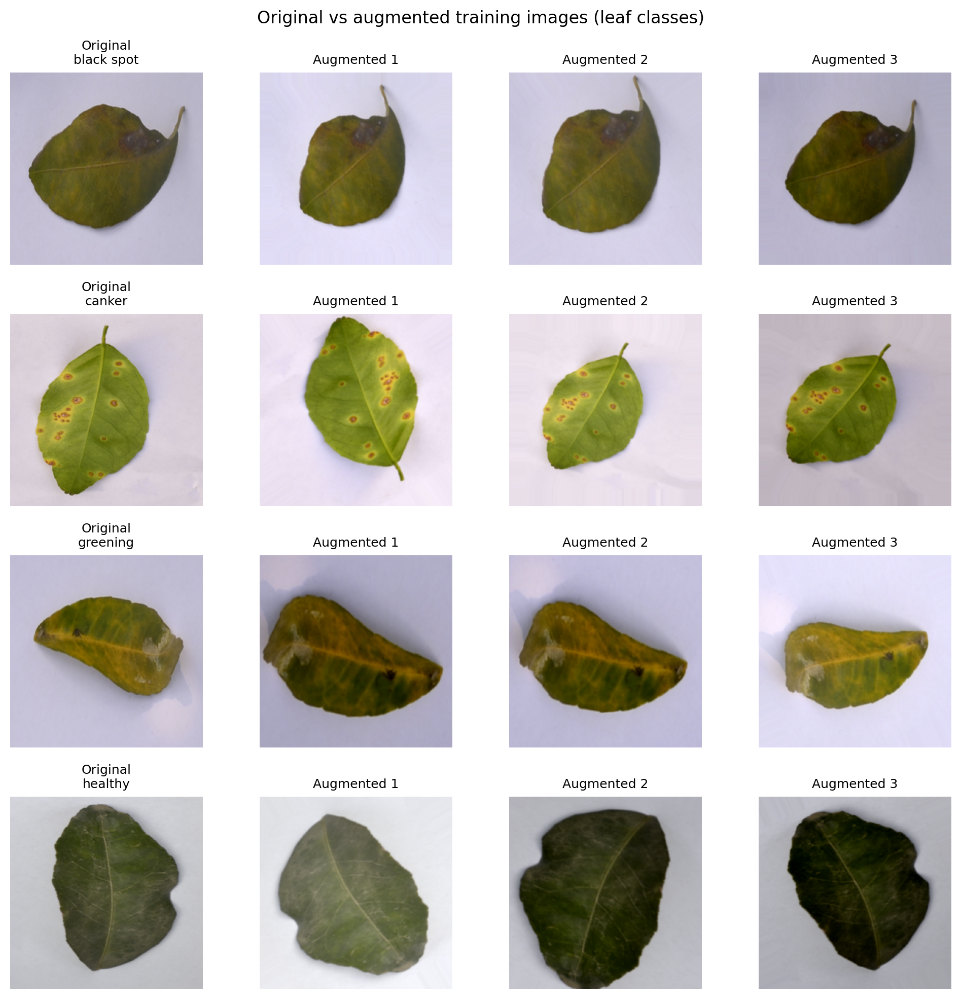
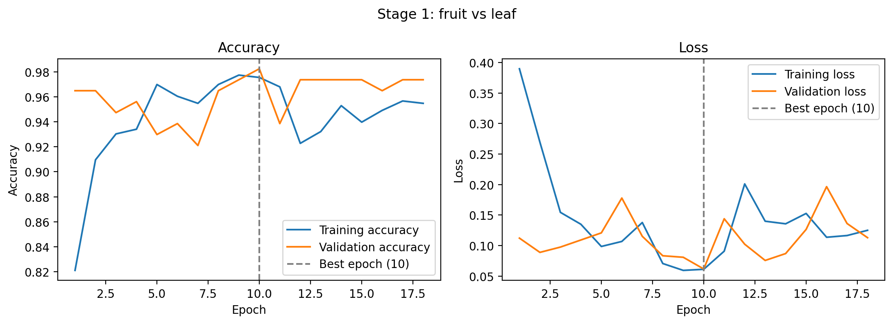
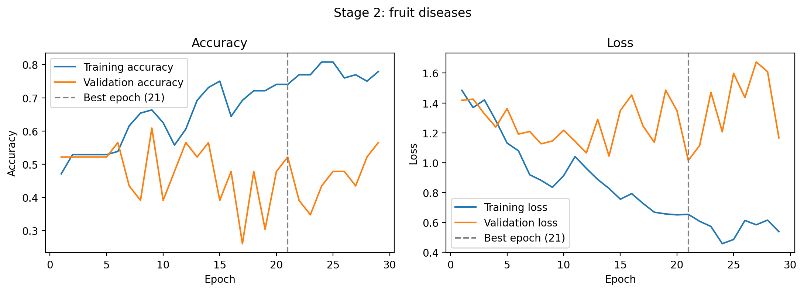
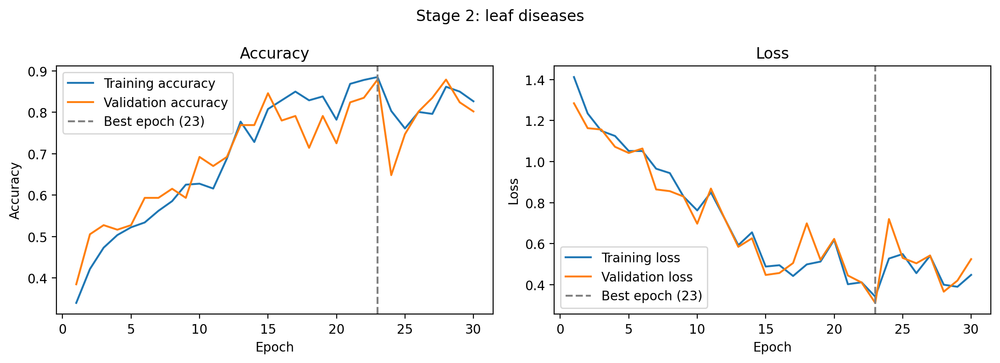
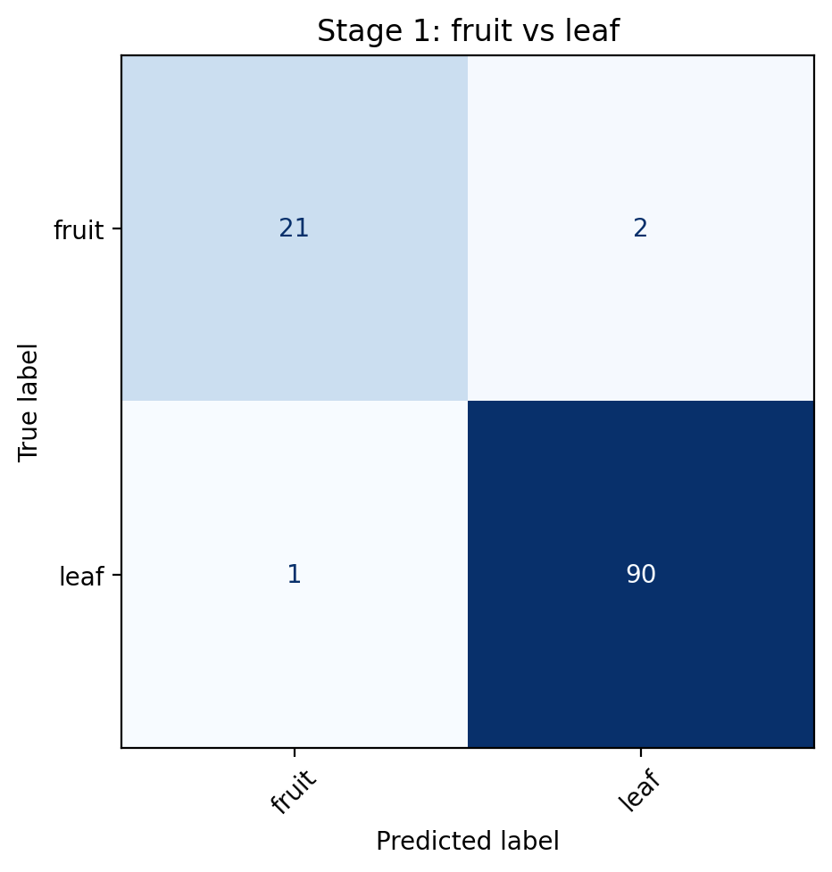
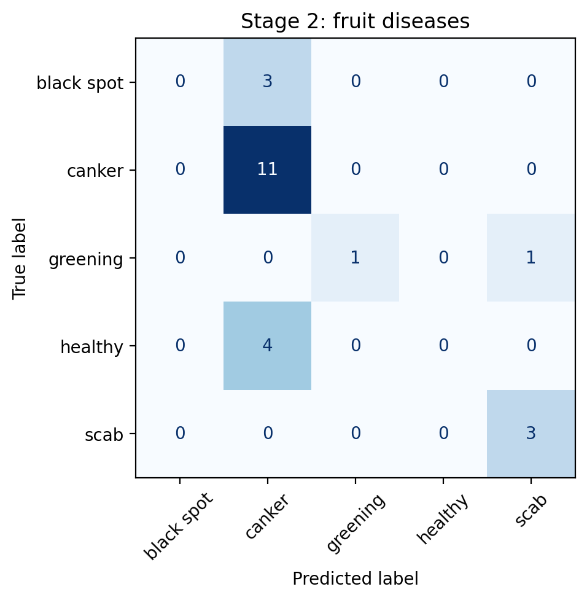
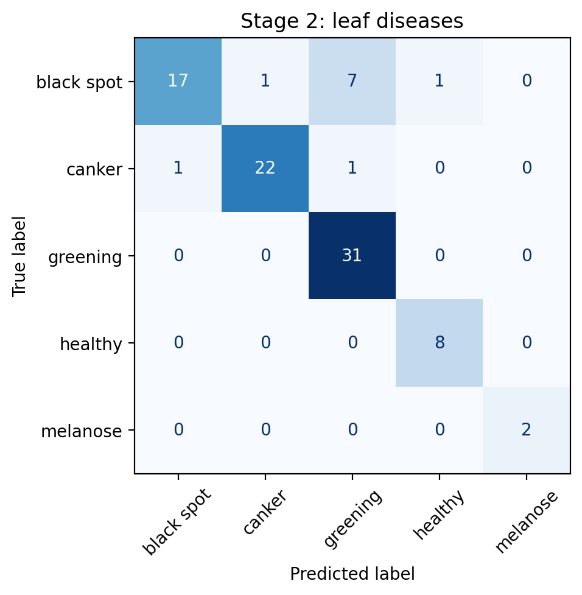
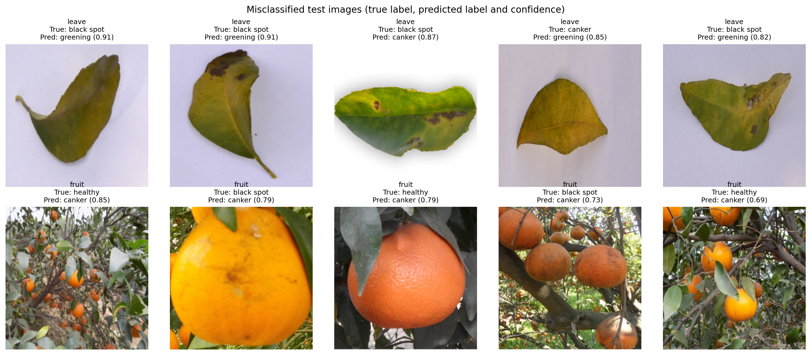

# Citrus Disease Classification — Two-Stage CNN

A deep learning pipeline that classifies citrus fruit and leaf images by disease type, using a two-stage convolutional neural network built in TensorFlow/Keras.

> Built solo for BICT402: Data Science and Applications, University of Mpumalanga.

## Overview

Most citrus disease classifiers treat the problem as one flat multiclass task. This project splits it into two stages instead:

1. **Stage 1** — a binary CNN first decides whether an image is a **fruit** or a **leaf**
2. **Stage 2** — two separate CNNs (one trained on fruit images, one on leaf images) then classify the specific disease for that organ

This mirrors how a human would actually approach it — you'd look at *what* you're looking at before diagnosing *what's wrong with it* — and keeps each Stage 2 model focused on a narrower, more visually consistent class set.

## Dataset

759 citrus images across 10 fine-grained classes (5 disease categories × 2 organs), provided by the University of Mpumalanga for this course. **Not included in this repo** — dataset is custom/university-assembled and not publicly redistributable.

| Organ | Images | Classes |
|---|---|---|
| Leaves | 609 | black spot, canker, greening, healthy, melanose |
| Fruits | 150 | black spot, canker, greening, healthy, scab |

Split: 70% train / 15% validation / 15% test, stratified by class (531 / 114 / 114 images).

## Preprocessing & Augmentation

- Images resized to 128×128 (Stage 1) and 256×256 (Stage 2), pixel values normalised to [0, 1]
- Five augmentation operations applied during training: horizontal/vertical flip, rotation, zoom, brightness jitter, and contrast jitter


*Each row shows one original leaf alongside three randomly augmented versions used during training.*

## Architecture

- **Stage 1** (binary, fruit vs. leaf): 6 convolutional layers (32→64→128 filters) with max-pooling, followed by 2 dense layers and a sigmoid output
- **Stage 2** (multiclass, 5 disease classes per organ): 4 convolutional layers (16→32→64→128 filters) with max-pooling, followed by dense layers and softmax output — trained separately for fruit and leaf

Full layer-by-layer summaries are in the notebook.

## Training

- Optimiser: Adam (lr = 0.001)
- Loss: binary cross-entropy (Stage 1), categorical cross-entropy (Stage 2)
- Batch size: 16, up to 30 epochs with early stopping on validation loss

## Results

| Model | Test Accuracy | Notes |
|---|---|---|
| Stage 1 (fruit vs. leaf) | **98.25%** | Near-perfect separation |
| Stage 2 — Leaf disease | **91.2%** | Strong performance, 609 leaf images available |
| Stage 2 — Fruit disease | **60.9%** | Underperformed — see analysis below |

**Stage 1 — fruit vs. leaf** (converges fast, best epoch 10 of 18 before early stopping):



**Stage 2 — fruit diseases** (validation accuracy stays well below training accuracy throughout — a classic small-dataset overfitting signature):



**Stage 2 — leaf diseases** (training and validation accuracy track closely — healthy generalisation):



### Confusion Matrices

| Stage 1 (fruit vs. leaf) | Stage 2 — fruit diseases | Stage 2 — leaf diseases |
|---|---|---|
|  |  |  |

The fruit-disease confusion matrix shows the clearest failure pattern: the model never once correctly predicted `black spot` (0/3) or `healthy` (0/4) — both were almost always predicted as `canker`, the fruit class with the most training examples (55 of 104 fruit training images). This is a textbook class-imbalance symptom: the model learned to default to the majority class rather than genuinely distinguishing early-stage symptoms.

## Error Analysis


*Five of the 17 Stage 2 misclassifications, with the model's true label, predicted label, and confidence.*

17 of the Stage 2 test images were misclassified. The fruit-disease model struggled most, frequently confusing `healthy` and `black spot` fruit with `canker` — consistent with the class-imbalance pattern above. On the leaf side, `black spot` was the main source of confusion, twice mistaken for `greening` (both examples show the leaf transitioning from green to yellow, which the model may be keying on rather than the black lesions themselves).

The most likely cause of the fruit model's weaker performance: the fruit dataset is small (150 images total, with some classes under 20 samples) and imbalanced toward `canker`, so the model had far less balanced visual variation to learn from compared to the leaf model's 609 images. Several misclassifications also had high confidence (0.7–0.9) despite being wrong, suggesting the model learned a biased shortcut (e.g. "yellowing = canker/greening") rather than the correct discriminating features.

## Proposed Improvements

- Collect more fruit-disease images, particularly for the `black spot`, `greening`, and `scab` classes, to address the class imbalance driving Stage 2's weaker fruit performance
- Apply transfer learning (e.g. a pretrained MobileNet/EfficientNet backbone) for the fruit model specifically, since small datasets benefit disproportionately from pretrained features
- Explore class-weighted loss to reduce bias toward the majority `canker` class in the fruit model

## Project Structure

```
citrus-disease-cnn/
├── README.md
├── notebook/
│   └── citrus_disease_cnn.ipynb
├── report.pdf
├── results/
│   ├── augmentation_examples.png
│   ├── learning_curves_stage1.png
│   ├── learning_curves_fruit.png
│   ├── learning_curves_leaf.png
│   ├── confusion_matrix_stage1.png
│   ├── confusion_matrix_fruit.png
│   ├── confusion_matrix_leaf.png
│   └── error_analysis.png
└── requirements.txt
```

## Reproducing

```bash
pip install -r requirements.txt
```

Open `notebook/citrus_disease_cnn.ipynb` in Jupyter or Google Colab. The dataset is not included — point `DATA_DIR` at your own copy of the citrus dataset, organised into `<organ>_<disease>` class folders.

## Tech Stack

TensorFlow / Keras, scikit-learn, pandas, matplotlib

## Author

Tiyani Khubayi — [GitHub](https://github.com/Taliano10) | [LinkedIn](https://www.linkedin.com/in/tiyani-khubayi-264392347/)
